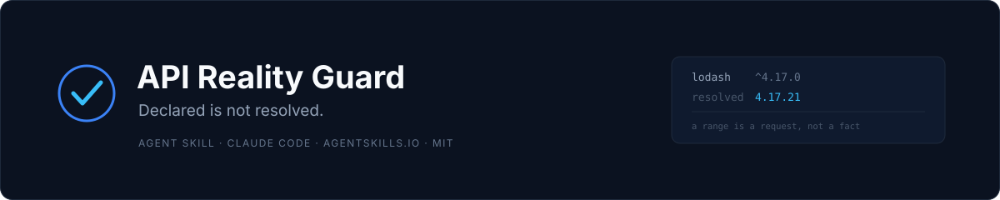
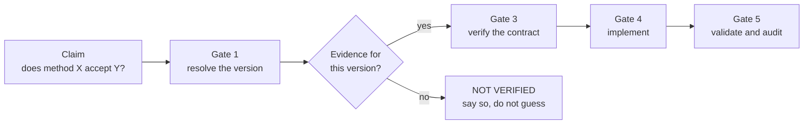

<p align="center">
  
</p>

<p align="center">
  <a href="https://github.com/Reda3D/api-reality-guard/actions/workflows/ci.yml"></a>
  
  
  
  
  <a href="https://github.com/Reda3D/api-reality-guard/releases"></a>
</p>

<p align="center">
  <b>An Agent Skill that stops AI-written code from being built on APIs that do not exist.</b><br>
  <sub>For Claude Code and any host implementing the <a href="https://agentskills.io">agentskills.io</a> format.</sub>
</p>

---

## The failure it prevents

An agent writes a call that looks right. It imports, it type-checks in the
agent's head, it reads like the documentation. Then it fails at runtime — because
the method was renamed in v3, the keyword argument came from v2, or the package
name was invented whole.

The cause is almost never carelessness. It is that **the documentation the model
remembered describes a different version than the one your lockfile pins**.

API Reality Guard does not try to out-guess the model with another model. It
imposes a procedure: resolve the version that is actually installed, find evidence
that applies to *that* version, and label every claim with what was checked.

## How it works



Six gates, ten non-negotiable rules, five evidence labels. The procedure is in
[`SKILL.md`](SKILL.md); the depth is in
[`references/verification-protocol.md`](references/verification-protocol.md).

## Quick start

```bash
git clone https://github.com/Reda3D/api-reality-guard.git
cd api-reality-guard

# 1. Check the package against the standard (no dependencies needed)
python scripts/validate_skill.py .

# 2. Run the tests
python -m unittest discover -s tests -v

# 3. Try it on the bundled fixture
python scripts/inspect_project.py examples/sample-project \
  --package lodash --package express --package requests
```

Install into a host:

| Host | Command |
|---|---|
| Claude Code (Windows) | `Copy-Item -Recurse . "$env:USERPROFILE\.claude\skills\api-reality-guard"` |
| Claude Code (macOS / Linux) | `cp -r . ~/.claude/skills/api-reality-guard` |
| Other hosts | Copy the directory to the location your host documents for skills |

Restart the host, then invoke the skill by name on a real task.

## Demo

Real output from the fixture in [`examples/sample-project`](examples/sample-project),
which deliberately contains a manifest *and* a lockfile for the same dependency:

```text
$ python scripts/inspect_project.py examples/sample-project \
    --package lodash --package express --package requests

API REALITY GUARD — READ-ONLY PROJECT INVENTORY
================================================
Root: examples/sample-project
Files examined: 4 / 20000
Scan status: COMPLETE

Project markers:
- [JavaScript / TypeScript] package-lock.json — Dependency lockfile (lockfile)
- [JavaScript / TypeScript] package.json — Package manifest (manifest)
- [Python] requirements.txt — Requirements file (manifest)

Runtime version markers:
- .python-version — Python runtime version = 3.11.9

Requested package resolution:
- express  = 4.18.2       [resolved / exact]    package-lock.json
- express  = ~4.18.0      [declared / declared] package.json
- lodash   = 4.17.21      [resolved / exact]    package-lock.json
- lodash   = ^4.17.0      [declared / declared] package.json
- requests = >=2.31,<3    [declared / declared] requirements.txt
```

Read the last line carefully. `requests` has **no lockfile**, so the tool refuses
to produce a version for it. That is the whole point: a range is a request, not a
fact.

## Declared versus resolved

Every resolution record carries its own provenance, so a consumer never has to
infer authority from prose.

```json
{
  "package": "lodash",
  "version": null,
  "constraint": "^4.17.0",
  "authority": "declared",
  "confidence": "declared",
  "source_path": "package.json"
}
```

| Field | Values | Meaning |
|---|---|---|
| `authority` | `resolved` | The file states what was installed or locked |
| | `declared` | The file states what was requested. **Not a version** |
| `confidence` | `exact` | Produced by a real parser (`json`, or `tomllib` on 3.11+) |
| | `best_effort` | Produced by a line scanner. A lead, confirm with native tooling |
| | `declared` | A range from a manifest |
| `source_path` | | Where the evidence lives. Cite it |
| `line` | | Line number when the format provides one |

An agent that quotes `^4.17.0` and then cites documentation for the latest release
has verified nothing. This table exists to make that failure visible.

## The evidence model

The skill requires every material claim to carry one of five labels.

| Label | Means |
|---|---|
| `VERIFIED IN PROJECT` | Confirmed in the installed package or project types for this environment |
| `VERIFIED IN OFFICIAL DOCS` | Confirmed in official documentation for the matching version |
| `TESTED LOCALLY` | Exercised by a named local test |
| `PARTIALLY VERIFIED` | Some contract details are supported, others unresolved |
| `NOT VERIFIED` | No sufficient evidence. The honest answer |

A claim may carry more than one. `VERIFIED` is never applied to a whole feature
when one part was checked.

## The two helpers

Both are read-only, offline, and standard library only.

| Script | Reads | Purpose |
|---|---|---|
| `inspect_project.py` | Filenames only, by default | Inventory of manifests, lockfiles and runtime markers |
| `inspect_project.py --package NAME` | Allowlisted manifests and lockfiles | Adds declared and resolved versions |
| `validate_skill.py` | `SKILL.md` and the package tree | agentskills.io conformance |

`inspect_project.py` exit codes: `0` complete, `1` incomplete (truncated scan or
unreadable paths), `2` usage or I/O error.

### Supported lockfiles and manifests

`package-lock.json` · `package.json` · `yarn.lock` · `pnpm-lock.yaml` ·
`requirements*.txt` · `Pipfile.lock` · `poetry.lock` · `uv.lock` ·
`pyproject.toml` · `Cargo.lock` · `Cargo.toml` · `go.mod` · `composer.json` ·
`composer.lock` · `Gemfile.lock` · `pubspec.lock`

Anything else is reported as unsupported rather than silently ignored. The
supported set is listed in every report.

## What it does not do

- **It does not prove an API behaves correctly for your data.** It proves the
  contract you are coding against exists.
- **It does not run your project, install anything, or reach the network.** The
  bundled scripts have no HTTP client and no subprocess call.
- **It does not replace tests.** It tells you which tests are worth writing.
- **It does not enforce compliance.** An agent can ignore the procedure. What it
  cannot do is hide it: a claim without a label is a visible omission.

## Security model

The scripts run on your machine, so their boundaries are stated rather than
implied.

| Boundary | Guarantee |
|---|---|
| Source code | Never read, in any mode |
| File contents | Only allowlisted metadata files, and only with `--package` |
| Symlinks | Never followed, for directories or files |
| Read size | 2 MiB per metadata file, 4 KiB per runtime marker, 200 000 lines per text format |
| Network | No HTTP client, no socket, no DNS |
| Execution | No `subprocess`, no `eval`, no import of project code |
| Completeness | Unreadable paths are reported and force `scan_complete: false` |
| Paths | The absolute project path is not emitted unless you passed one |

`validate_skill.py` parses frontmatter with PyYAML when available, and otherwise
with a narrow reader that **fails closed** on anything it cannot classify. It
never falls back to regular-expression parsing of YAML — that technique silently
truncates multi-line descriptions, and it is the defect that version 1.0.0 exists
to fix. See [`references/audit-2026-10-29.md`](references/audit-2026-10-29.md).

## Repository layout

```text
api-reality-guard/
├── SKILL.md                      # the procedure: six gates, ten rules, five labels
├── references/
│   ├── verification-protocol.md  # evidence ranking, per-ecosystem sources, failure modes
│   └── audit-2026-10-29.md       # the defect audit behind 1.0.0
├── scripts/
│   ├── inspect_project.py        # inventory and version resolution
│   └── validate_skill.py         # agentskills.io conformance
├── tests/                        # 58 tests, stdlib unittest, no fixtures on disk
├── examples/sample-project/      # reproducible demo fixture
├── assets/banner.svg
├── VALIDATION_REPORT.md          # what was run, and what was not
├── CHANGELOG.md
├── SECURITY.md
└── CONTRIBUTING.md
```

## Verification status

| Check | Result |
|---|---|
| Tests | 58 passing, both frontmatter parser paths |
| Conformance | `agentskills.io` compliant, name and description within bounds |
| CI | 13 jobs green: Linux, macOS, Windows × Python 3.9, 3.11, 3.13 |
| Regression guards | Over-long folded description rejected; no regex YAML parsing |
| Host installation | **Not verified.** The package has not been installed into a live workspace |

Every claim above corresponds to a command in
[`VALIDATION_REPORT.md`](VALIDATION_REPORT.md), including the ones that failed
first.

## Requirements

- Python 3.9 or newer.
- No third-party runtime dependency. PyYAML is optional and only makes validation
  stricter.
- `tomllib` is used automatically on Python 3.11+; older versions fall back to a
  labelled best-effort scan of TOML lockfiles.

## License

MIT — see [`LICENSE.txt`](LICENSE.txt).
